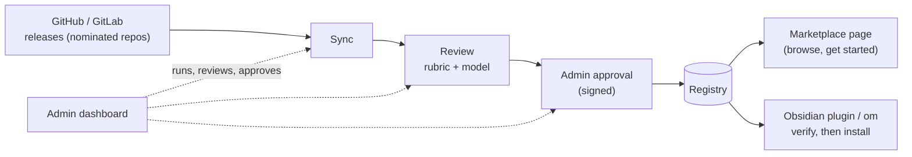

# Obsidian On-Prem Marketplace

An internal plugin marketplace for [Obsidian](https://obsidian.md). Plugins come from GitHub or GitLab repos **you** nominate,
every version is reviewed and approved before users can install it, and the client refuses anything unapproved or altered.

Obsidian's built-in plugin browser can't be pointed at a custom source. This project fills that gap with a **static
registry** (plain files behind a web server), a **web page for users**, a **dashboard for admins**, and a small **Obsidian
plugin** that browses, installs and updates from the registry.



## For users

Open your marketplace's address in a browser. The **Plugins** tab lists what has been approved, with search, sorting, version,
author, how recently it was updated and how many colleagues use it, and a link to each plugin's source for feedback. **Get started**
walks you through the one-time setup: download `om.exe` (Windows), run three commands to point it at the marketplace and pin its
public key, then enable the **On-Prem Marketplace** plugin in Obsidian. From then on you browse, install and update plugins from
inside Obsidian (store icon in the ribbon). Missing something? **Nominate a plugin** opens an issue for the admins.

## For admins

The admin dashboard (HTTPS, password and/or client certificate sign-in) is where the work happens:

| Tab | What you do there |
|---|---|
| **Plugins** | See every mirrored version with its review verdict and approval state. Review, re-review, approve (signed by a separate container), hold back, release or withdraw a version. Open the full review report, or **Report issue** to post the review's text on the plugin's own repository. Keep triage notes. |
| **Clients** | See which clients checked in, what they last fetched, and which Obsidian versions cannot run a plugin's newest release (and the newest approved release they can still run). |
| **Activity** | Recent registry events (checks, downloads, installs). |
| **Repositories** | Add a plugin repository by its web address (GitHub, GitHub Enterprise or GitLab), run the same acceptance check sync applies, and mirror it. |
| **Nominations** | Read nomination issues from your tracker; add the repository, or decline with a reason, and close the issue, each only on your click. |
| **Rubric** | See the checks reviews are made against, which reviews are stale after a rubric change, and a free (no model) estimate of what a change would affect. |
| **Forwarding** | Stream events to Splunk (HTTP Event Collector). |
| **Jobs** | Output of sync and review runs. |

Safety by design: the admin process never holds the signing key or a model credential. Approvals are signed by a separate
**signer** container with no network, reviews run in a separate **reviewer** container, and every privileged action is
written to an audit log. See [Security & trust model](docs/concepts/security.md).

## What you get

- **Curated catalog.** Only repos an admin nominates are mirrored, and a retention policy keeps the newest few patches, minors and majors. No application server or database; the registry is a folder served by nginx (or any static web server).
- **Open, extensible review.** Each version gets deterministic checks (`eval`, `child_process`, network calls, obfuscation, ...) plus a model review. The checks are readable data in [`rubric/`](rubric/README.md); anyone can propose one by pull request. Reports list the plugin's manifest, every check, the model used, and how much code the model actually saw.
- **Human approval, signed.** Approval binds the exact file hashes (ECDSA P-256). Approval is refused unless the review passed, or an override reason is recorded.
- **Client enforcement.** In `require-signed` mode the client installs only versions approved under a key pinned in the vault. A file altered on the web server fails the check.
- **Your model.** Review runs on Claude Code, any OpenAI-compatible endpoint (base URL and API key), or your own harness wrapper.

## Quick start (containers)

Requires Docker (or Rancher Desktop) with Compose, and Node 20+ for the one-time setup commands.

1. Create the config folder, a signing key and an admin user, following [Admin service](docs/admin.md#setup) (the signing key stays
   in your secret store or in `secrets/`; only the **public** key goes in `config/`).
2. Start everything:

   ```powershell
   docker compose --profile signer up -d
   ```

3. Open the registry at `http://localhost:8080` (the user page) and the admin dashboard at `https://localhost:8443`.
4. In the dashboard: **Sync now**, **Review** a version, **Approve** it. It now shows up on the user page and installs from Obsidian.

Reviews need a model: set `ANTHROPIC_API_KEY` for Claude Code, or configure an OpenAI-compatible service
([how](docs/deploy.md#reviews-with-an-openai-compatible-model-service)). Running on a cluster? Read [Deploying](docs/deploy.md)
first: it covers volumes, which secret goes to which container, probes, and what has not been verified yet.

### Without containers (command line)

Everything the dashboard does is also available from the command line, which suits scripts and headless hosts.
PowerShell shown; use `;` or separate lines (not `&&`) in Windows PowerShell 5.1.

```powershell
npm install
npm run build

# 1. Point registry.config.json at your git server and nominate repos, then mirror their releases
$env:GITHUB_TOKEN = "<read-only token>"          # needed for private repos and to avoid rate limits
node packages/sync/dist/cli.js

# 2. One-time: signing key (keep keys/ secret, it is gitignored)
node packages/sync/dist/cli.js keygen keys

# 3. Review, then approve what you trust
$env:ANTHROPIC_API_KEY = "<key>"                 # for the default Claude Code reviewer
node packages/sync/dist/cli.js review <id>@<version>
node packages/sync/dist/cli.js approve <id>@<version> --key keys/signing-key.pem

# 4. Serve registry/ from any static web server, e.g. for a test:
npx http-server registry -p 8080 --cors -c-1

# 5. Install the marketplace into a vault with the public key pinned (require-signed)
node scripts/bootstrap-vault.mjs <vaultPath> http://127.0.0.1:8080 keys/public-key.txt
```

`om` (`npm run build:exe` produces `dist/om.exe`) is the user-side command line: `om vaults`, `om init --registry <address> --vault <name>`,
`om marketplace`, `om list`, `om install`, `om update`. See [Overview](docs/README.md).

Want to see it first? The [`demo/`](demo) folder is a playbook for an offline walkthrough with a fake GitHub, a benign plugin and an
inert, deliberately suspicious one, and it holds a recording of the client plugin lifecycle. **It is a draft that has not yet been run end to end**
(the command-line scripts predate the dashboard and the user page, and the container track is not built yet); the to-do list is in
[`demo/README.md`](demo/README.md).

## Status

**Experimental** (pre-release tags such as `v0.3.0-experimental.7`). Unit-tested (`npm test`), and the user page and dashboard have a
browser smoke test (`npm run ui-check`). It runs under Docker/Rancher Desktop; it has **not** yet been run on Kubernetes, against an
on-prem GitHub or GitLab, managed endpoints, an on-prem review model, or a real Splunk. [Deploying](docs/deploy.md) lists exactly
what is unverified.

Known gaps (details in [Security & trust model](docs/concepts/security.md)): the catalog (`index.json`) is unsigned and has no
expiry, there is no revocation list, and a single pinned key has no rotation story. The review is **advisory evidence for a human
decision, not a guarantee of safety**; large minified plugins may get only a partial review and the report says so.

## Docs

| | |
|---|---|
| [Overview](docs/concepts/overview.md) | How the pieces fit; start here |
| [Admin service](docs/admin.md) | The dashboard, containers, configuration, logs and Splunk |
| [Deploying](docs/deploy.md) | Hand-off for a platform team: volumes, secrets, networking, probes, what is unverified |
| [Registry & sync](docs/concepts/registry-and-sync.md) | Running and configuring sync (admins) |
| [Review, approval & signing](docs/concepts/attestation.md) | Review providers, keys, client modes, filtering |
| [The review rubric](docs/concepts/rubric.md) | Exactly what is checked ([contribute a check](rubric/README.md)) |
| [Install lifecycle](docs/concepts/install-lifecycle.md) | What the client does (users) |
| [Security & trust model](docs/concepts/security.md) | Boundaries, protections, gaps (security reviewers) |
| [Developer guide](docs/concepts/developer-guide.md) | Code layout and common changes |

Licensed under the [MIT License](LICENSE).

Layout: `packages/shared` (types and signature verification), `packages/sync` (sync, review, approve, keygen), `packages/admin`
(the dashboard service), `packages/cli` (`om`), `packages/plugin` (the Obsidian plugin), `deploy/` (nginx, landing page, container
images), `rubric/` (the checks), `docs/`, `demo/`.
