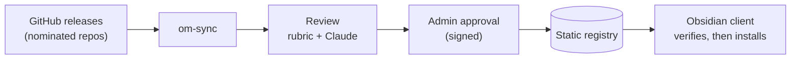

# Obsidian On-Prem Marketplace

An internal plugin marketplace for [Obsidian](https://obsidian.md). Plugins come from GitHub repos **you** nominate,
every version is reviewed and approved before users can install it, and the client refuses anything unapproved or altered.

Obsidian's built-in plugin browser can't be pointed at a custom source. This project fills that gap with a **static
registry** (plain files on any web server) and a small **Obsidian plugin** that browses, installs and updates from it.



## What you get

- **Curated catalog.** Only repos an admin nominates are mirrored. No server code, no database; serve the folder from IIS, nginx or a file share.
- **Open, extensible review.** Each version gets deterministic checks (`eval`, `child_process`, network calls, obfuscation, ...) plus an LLM review. The checks are readable data in [`rubric/`](rubric/README.md); anyone can propose one by pull request. Reports list every check, the model used, and how much code the model actually saw.
- **Human approval, signed.** Approval binds the exact file hashes (ECDSA P-256). `approve` refuses unless the review passed, or an override reason is recorded.
- **Client enforcement.** In `require-signed` mode the plugin installs only versions approved under a key pinned in the vault. A file altered on the web server fails the check.
- **Filtering.** Hold versions out of the catalog until they pass review (`publishPolicy`), hide unapproved plugins, optionally require a passing review on the client.
- **Your model.** Review runs on Claude Code, an OpenAI-compatible endpoint, or your own harness wrapper.

## Quick start

Requires Node 20+. PowerShell shown; use `;` or separate lines (not `&&`) in Windows PowerShell 5.1.

```powershell
npm install
npm run build

# 1. Point registry.config.json at your GitHub and nominate repos, then mirror their releases
$env:GITHUB_TOKEN = "<read-only token>"          # needed for private repos and to avoid rate limits
node packages/sync/dist/cli.js

# 2. One-time: signing key (keep keys/ secret, it is gitignored)
node packages/sync/dist/cli.js keygen keys

# 3. Review, then approve what you trust
$env:ANTHROPIC_API_KEY = "<key>"                 # for the default Claude Code reviewer
node packages/sync/dist/cli.js review <id>@<version>
node packages/sync/dist/cli.js approve <id>@<version> --key keys/signing-key.pem

# 4. Serve registry/ from any static web server, e.g. for a test:
npx http-server registry -p 8080 --cors -c-1

# 5. Install the marketplace into a vault with the public key pinned (require-signed)
node scripts/bootstrap-vault.mjs <vaultPath> http://127.0.0.1:8080 keys/public-key.txt
```

Then in Obsidian: Settings > Community plugins > turn off Restricted mode, reload, and use the store icon in the ribbon.

Want to see it first? The [`demo/`](demo) folder runs the whole flow offline against a fake GitHub with a benign plugin and
an inert, deliberately suspicious one.

## Status

A working, unit-tested prototype (`npm test`). It has been run in a home Obsidian vault and the review stage against Claude
Code; it has **not** yet been run against an on-prem GitHub, managed endpoints, or on-prem review models.

Known gaps (details in [Security & trust model](docs/concepts/security.md)): the catalog (`index.json`) is unsigned and has no
expiry, no revocation list, a single pinned key with no rotation, no audit log. The review is **advisory evidence for a human
decision, not a guarantee of safety**; large minified plugins get only a partial review and the report says so.

## Docs

| | |
|---|---|
| [Overview](docs/concepts/overview.md) | How the pieces fit; start here |
| [Registry & sync](docs/concepts/registry-and-sync.md) | Running and configuring sync (admins) |
| [Review, approval & signing](docs/concepts/attestation.md) | Review providers, keys, client modes, filtering |
| [The review rubric](docs/concepts/rubric.md) | Exactly what is checked ([contribute a check](rubric/README.md)) |
| [Install lifecycle](docs/concepts/install-lifecycle.md) | What the client does (users) |
| [Security & trust model](docs/concepts/security.md) | Boundaries, protections, gaps (security reviewers) |
| [Developer guide](docs/concepts/developer-guide.md) | Code layout and common changes |

Licensed under the [MIT License](LICENSE).

Layout: `packages/shared` (types and signature verification), `packages/sync` (CLI: sync, review, approve, keygen),
`packages/plugin` (the Obsidian plugin), `rubric/` (the checks), `docs/`, `demo/`.
