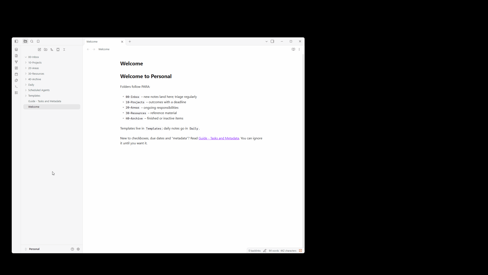

# Demo

An offline demo of the whole flow: a fake GitHub, a benign plugin and an inert, deliberately suspicious one. The scripts here
(`00-preflight.ps1`, `01-reset.ps1`, `02-start-servers.ps1`, `tamper.ps1`) set it up; the full demo script is still to be written.

## Client plugin lifecycle

A recording of the lifecycle of the marketplace client plugin in an Obsidian vault.

*(Recording: [demo_obsidian_onprem_marketplace_client.gif](demo_obsidian_onprem_marketplace_client.gif).)*
