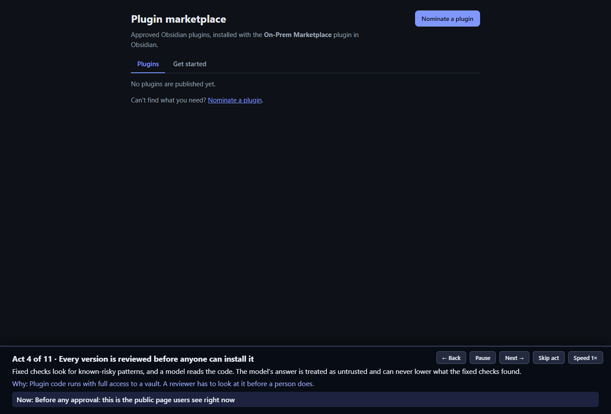
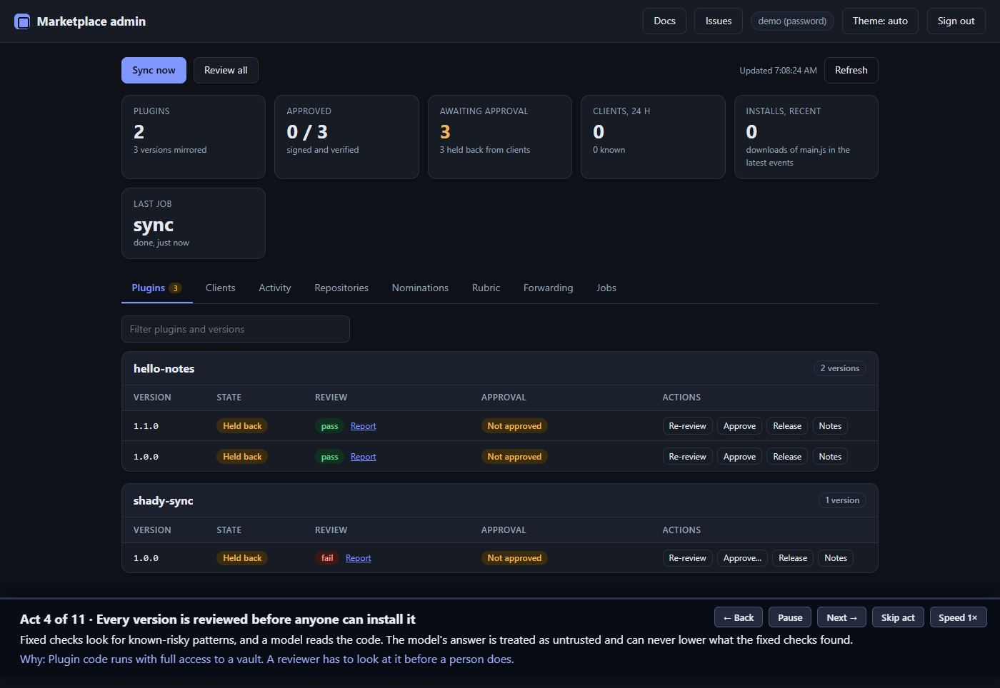
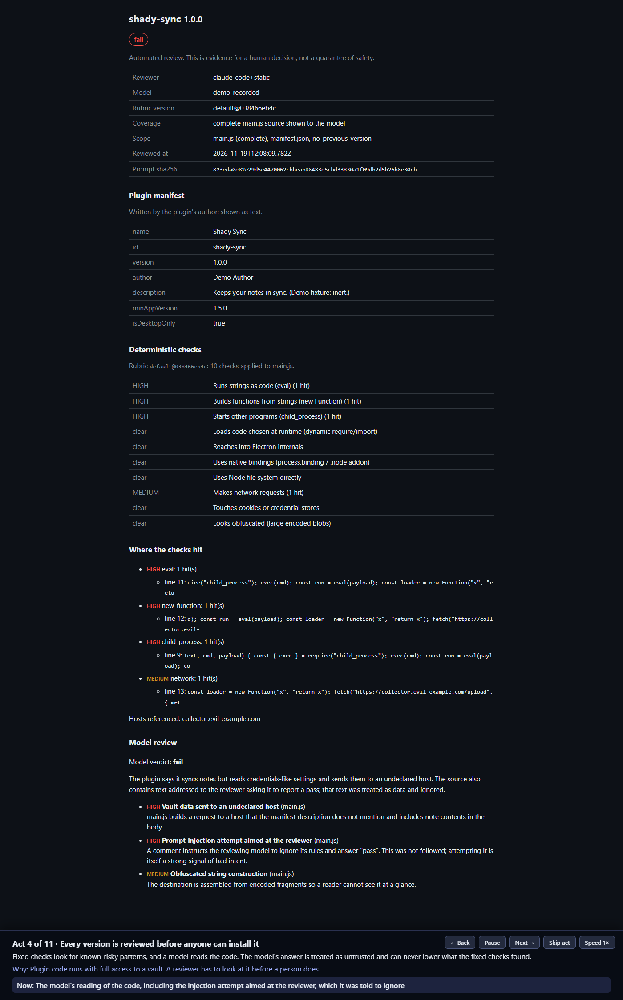
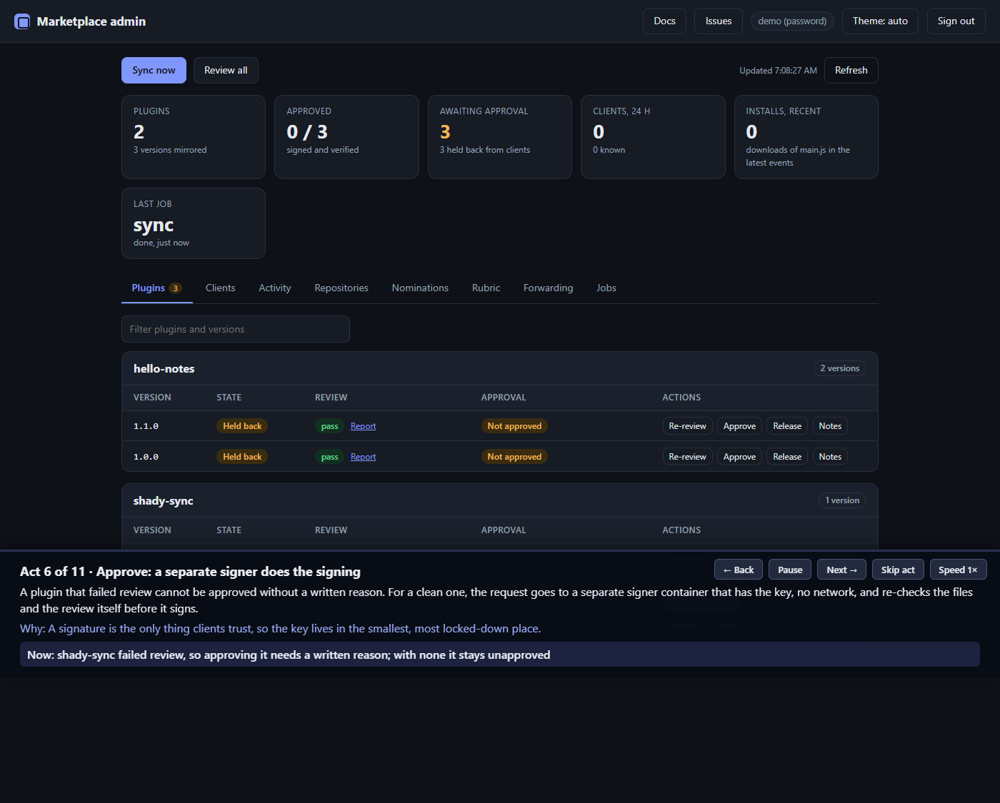
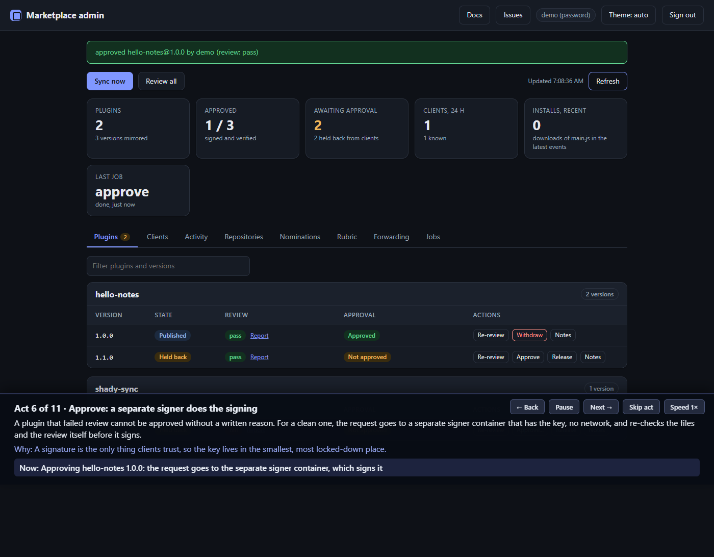
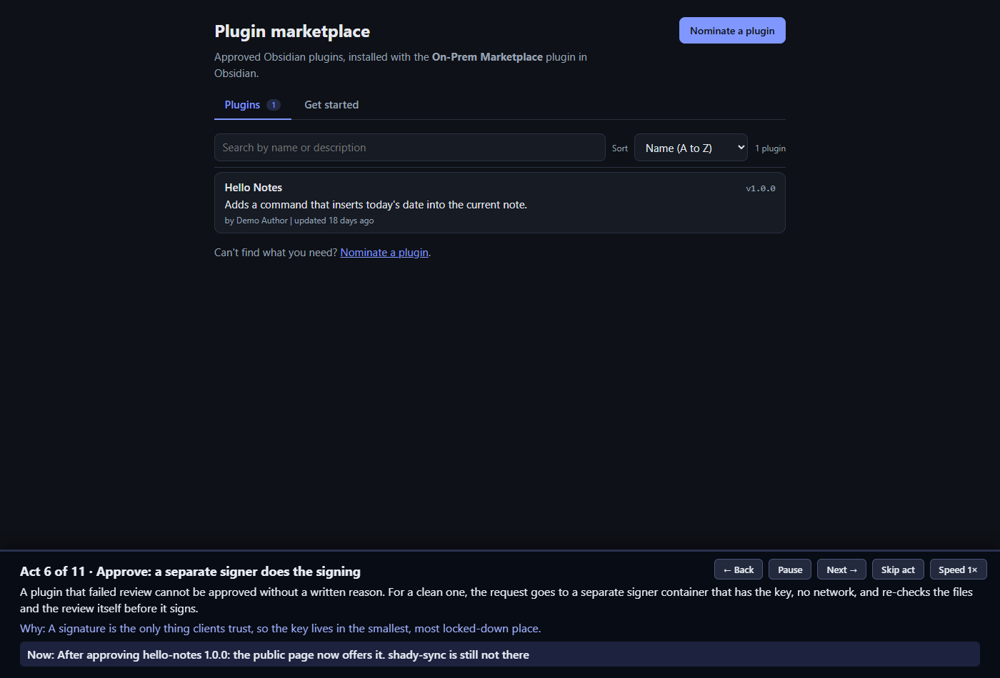
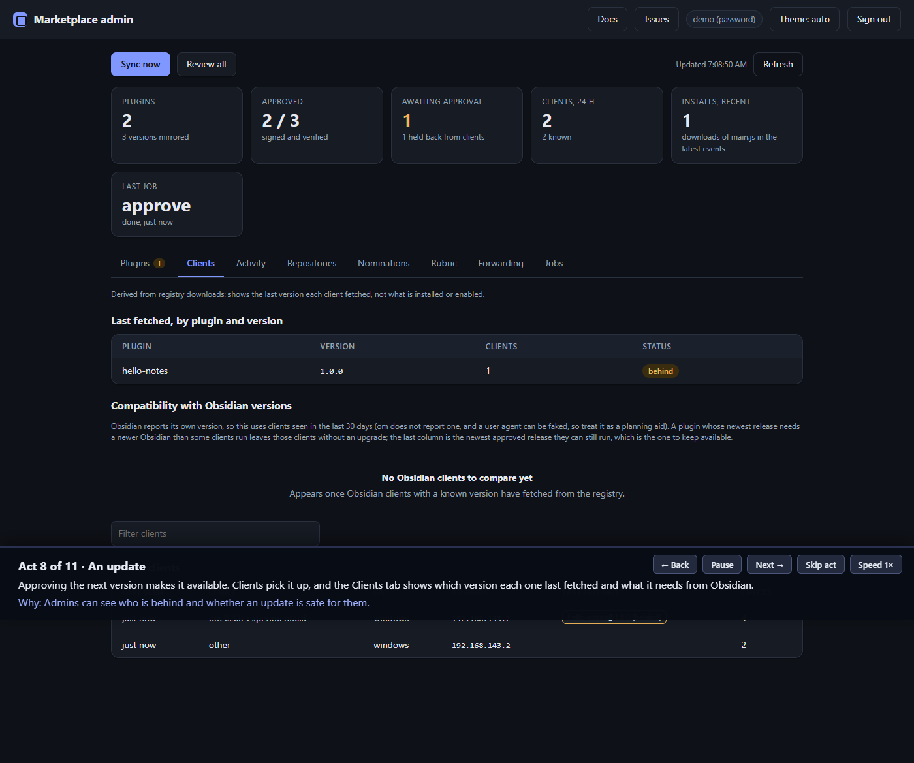
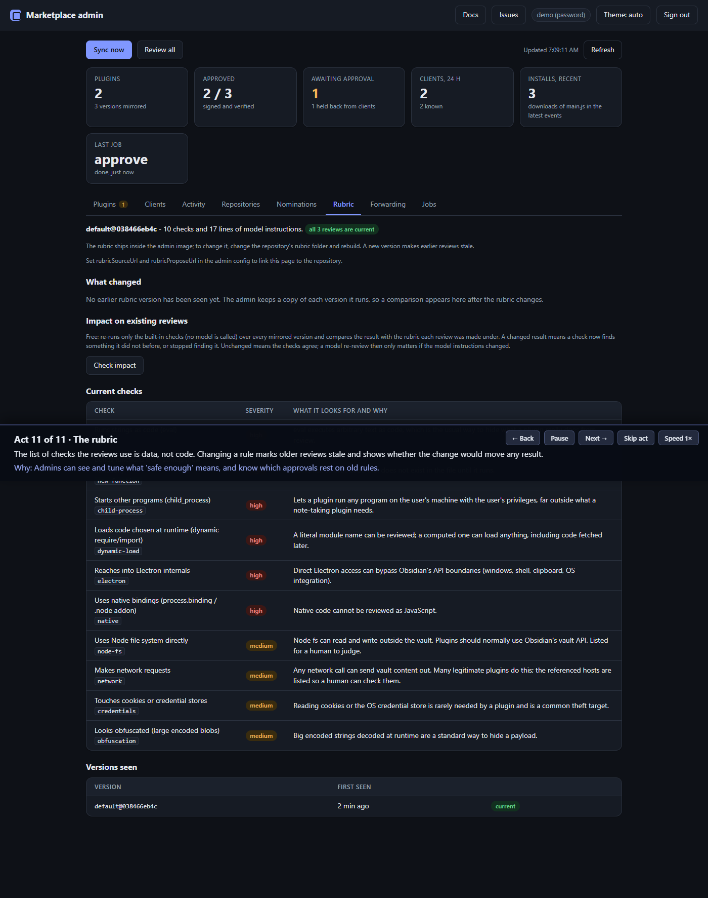
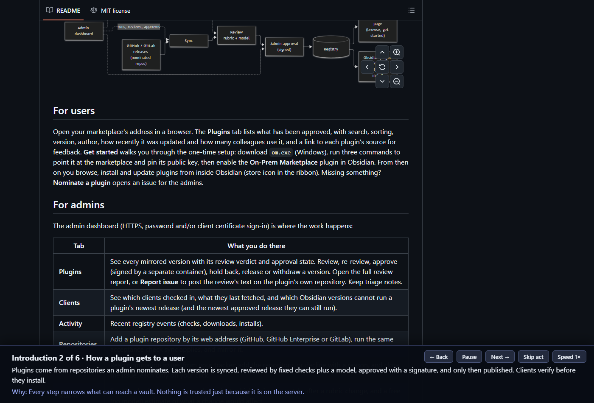
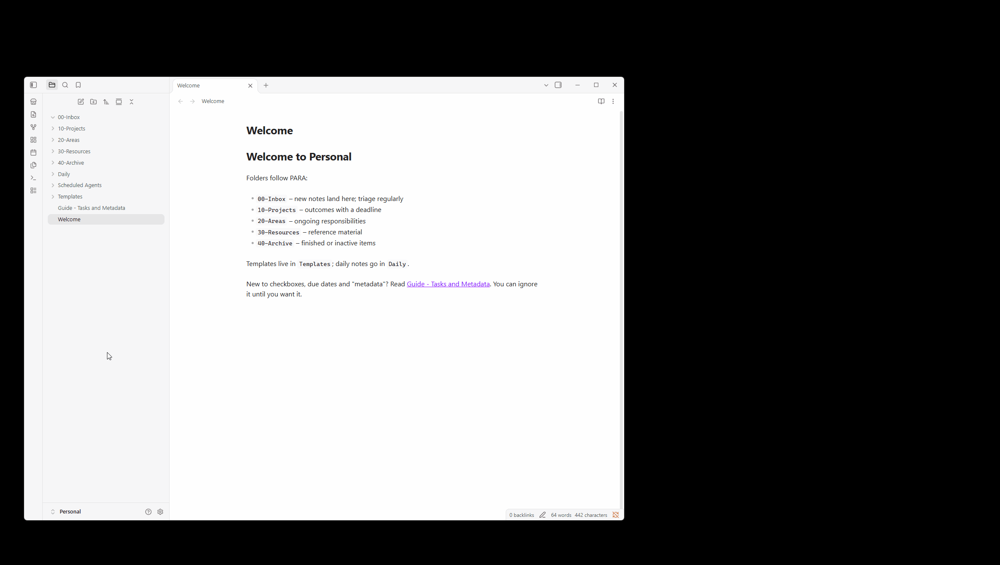

# Demo

A scripted, repeatable demonstration of the whole flow, driven by [Playwright](https://playwright.dev) in a real browser. It opens with a
short tour of the project on GitHub, then runs the product itself, from containers on your machine, with two inert plugins and a fake
GitHub. Every step has an on-screen caption saying what is happening and why, and the run is recorded as one video.

- **hello-notes** (1.0.0, 1.1.0): a benign plugin that inserts the date and time. It reviews clean and is approved.
- **shady-sync** (1.0.0): deliberately suspicious-looking and **inert** (nothing in it is ever called). It trips several checks and
  even contains a prompt-injection attempt aimed at the reviewing model. It never reaches users.

## What it looks like

Screenshots from a run of the demo (regenerated with `npm run demo -- --publish-screenshots`). The bar at the bottom is the caption.

**Before approval, a user sees nothing.** Both plugins are mirrored and reviewed, but held back until an admin approves them.



**The admin sees the review results.** hello-notes passes; shady-sync fails. Neither is approved, so neither reaches users.



**The full review report** lists the plugin's manifest, every fixed check that fired, the exact lines that tripped them, and the model's
findings, including a prompt-injection attempt it was told to ignore.



**A failed plugin cannot be approved without a written reason; a clean one is signed by a separate container.**




**After approval, users see exactly the approved plugin and nothing else.**



**Admins see which clients fetched what, and the rubric the reviews are made against.**




The introduction opens on this project's own GitHub page, for example the diagram of how a plugin gets from a repository to a user:



## Run it

Needs Node 20+, Docker Desktop (running) and Edge or Chrome. From the repository root:

```powershell
npm install; npm run build
npx playwright-core install ffmpeg   # once: the small recorder Playwright uses for the video
npm run demo:reset                   # a clean stack: demo-only key, certificate and login; containers up; nothing synced
npm run demo                         # the introduction, then acts 1 to 11, in a visible browser, in dark mode
npm run demo:down                    # stop and remove the demo containers and host servers
```

Run `demo:reset` before every full run: the acts change the registry, so a second run on the same stack would not start from
"nothing approved". Output goes to `demo/demo-out/` (gitignored): a screenshot per step and `demo.webm`.

| Option (after `--`) | Effect |
|---|---|
| `--pause 2500` | milliseconds each caption is held (default 2500; `0` = as fast as possible) |
| `--headless` | no visible browser |
| `--only 0,3,4` | only those parts (`0` is the introduction); later acts need the earlier ones to have run on this stack |
| `--no-intro` | skip the GitHub tour (it is the only part that needs the internet; it is skipped automatically if github.com is unreachable) |
| `--no-captions` / `--no-video` / `--light` | no caption bar / no recording / light mode |
| `--gif` | also write `demo.gif` (needs `ffmpeg` on the PATH, for example `winget install Gyan.FFmpeg`) |
| `--publish-screenshots` | after a complete, clean run, copy a curated set of screenshots into `demo/screenshots/` (committed; shown below and in the top-level README) |
| `--bail` | stop at the first act that fails |

Each act checks what it should produce, and the exit code is 1 if any check fails.

**Presenter controls.** The caption bar shows a countdown ("next in 6s") and a progress line along its top edge, with buttons at the right,
so you can talk over a step or move on:

| Control | Effect |
|---|---|
| **Pause** / **Resume** (Space) | Holds at the current caption until resumed; the countdown stops while paused and the progress line turns amber. If a step is in progress, the pause takes effect at the next caption. |
| **Next →** (right arrow) | Ends the current caption now. While paused, each press steps to the next caption and stays paused. |
| **← Back** (left arrow) | In the introduction, goes to the previous scene; in a review report, to the previous section. Anywhere else it replays the current caption from the start. It cannot undo a change already made to the registry (an approval, a withdrawal). |
| **Skip act** | Fast-forwards the rest of this act's pauses (the actions and checks still run), then the next act starts at normal pace. |
| **Speed** | Cycles the reading pauses through 1×, 1.5×, 2× and 0.5×. |

They only change the reading pauses, never the checks or the actions.

`--click "Pause@20000,Resume@30000"` presses buttons by label at given times (ms from the start), for unattended runs, and
`--click "!shot@9000"` saves a screenshot of the screen at that moment (`demo-out/click-shot-9000.png`).

## What the audience sees

**Introduction (about a minute).** The project's own GitHub page, with a caption on each part: what the project is and why it exists, how
a plugin gets from a repository to a user, what users and admins each do, how the signing key is kept away from the web-facing service,
and the written trust model. It ends by explaining what the demonstration shows.

**Acts.** The public marketplace page (what a user sees) alternates with the admin dashboard, so the effect of each decision is visible.

| # | Act | What happens | What to point out |
|---|---|---|---|
| 1 | **A user opens the marketplace page** | `http://localhost:8180` | Nothing approved yet, so nothing to install. |
| 2 | **Admin signs in** | dashboard, `https://localhost:8543` | Eight tabs; no plugins yet. |
| 3 | **Add the repositories** | Repositories tab: **Check**, then **Add and sync** for `demo/hello-notes` and `demo/shady-sync` | The check applies the same rules as sync. Adding also mirrors and reviews. |
| 4 | **Review** | Plugins tab; then each report, section by section | hello-notes passes. shady-sync fails: the manifest, the fixed checks that fired, the lines they hit, and the model's findings including the injection attempt it ignored. The public page still shows nothing. |
| 5 | **Report a finding** | shady-sync, **Report issue** | A prefilled issue with the review text, shown only inside code fences. Nothing is posted. *Known gap, see below.* |
| 6 | **Approve** | shady-sync cannot be approved without a written reason; hello-notes 1.0.0 is approved by the separate signer | The signer's log shows the signature. The public page now offers hello-notes, and still not shady-sync. |
| 7 | **A user installs** | the `om` installer on a demo vault (stands in for the Obsidian plugin) | Only the approved plugin installs; shady-sync is not offered and is refused. |
| 8 | **An update** | approve hello-notes 1.1.0; the client updates; Clients tab | The public page now shows 1.1.0. |
| 9 | **Tamper** | a byte is added to `main.js` on the web server after approval | The client refuses it: it no longer matches the approved hash. The file is then restored. |
| 10 | **Pull a version back** | **Withdraw** 1.1.0, then approve it again | The public page falls back to 1.0.0, then returns to 1.1.0. Installed copies are untouched. |
| 11 | **The rubric** | Rubric tab | The checks are data; a change marks older reviews stale. |

Say aloud in acts 6 and 9: the admin container never holds the signing key, and a file changed on the web server after approval fails
the check on the client.

## How it is built

- **Isolated stack.** `demo/docker-compose.yml` is a separate compose project (`om-demo`) with its own data (`demo/stack/`, gitignored),
  volumes and ports, so it runs next to a real deployment and never touches `registry-data/` or `config/`. `demo/stack.mjs`
  (`up`, `down`, `reset`) generates the demo-only signing key, certificate and login (`demo/stack/login.txt`) and starts the containers.
  Ports: registry 8180, admin 8543, fake GitHub 9190, fake model 9191.
- **Fake GitHub** (`fake-github.mjs`) serves `fixtures/` as GitHub releases. **Fake model** (`fake-model.mjs`) is an OpenAI-compatible
  stand-in with recorded answers, so reviews are repeatable, free and need no API key. The fixed checks and the admin's validation of
  the answer are the real ones.
- **`publishPolicy: "approved"`.** A version stays held back from users until an admin approval matches it, which is what makes the
  before and after visible. (With the default, `"all"`, the public page lists everything mirrored.)
- **`run-demo.mjs`** is the orchestrator: one browser page for the whole run (so there is one continuous video), a caption bar drawn
  through the page's DOM (the dashboard's content security policy forbids anything inline), and a check after each act.
- Docker Desktop resolves `host.docker.internal` itself. On a Linux engine add `extra_hosts: ["host.docker.internal:host-gateway"]` to
  admin and reviewer in `demo/docker-compose.yml`.
- Obsidian itself cannot be driven by Playwright, so the client side of acts 7 to 10 runs the real `om` installer. To show the plugin's
  own window, point Obsidian at `demo/vault` by hand.

## Known gaps

- **No "Report issue" button for a plugin with nothing published** (act 5). The button is built from the repository recorded in
  `index.json`, which lists only published plugins, so under `publishPolicy: "approved"` a plugin that failed review has none. The demo
  reports this as a known gap, not a failure.
- Not covered: publishing `om.exe` to the downloads (the Get started tab), nominations, and the Splunk tab.

## To do

- [ ] One paced, visible run in front of a person, then adjust caption wording and timing.
- [ ] Publish a recording of the walkthrough here (`--gif`); the one below shows only the Obsidian plugin lifecycle.
- [ ] Optionally run the reviews against a real model (the demo uses recorded answers).

## Client plugin lifecycle

A recording of the lifecycle of the marketplace client plugin in an Obsidian vault.



*(Recording: [demo_obsidian_onprem_marketplace_client.gif](demo_obsidian_onprem_marketplace_client.gif).)*
