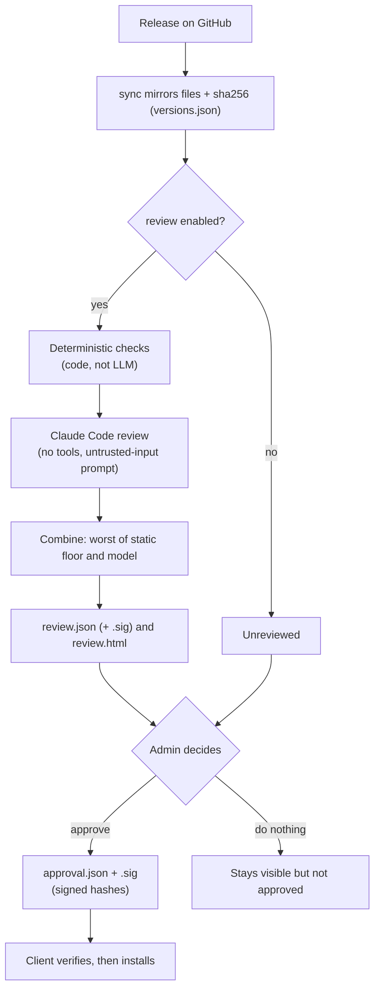
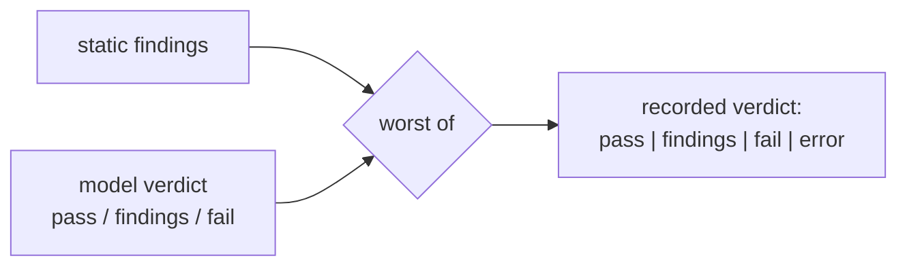
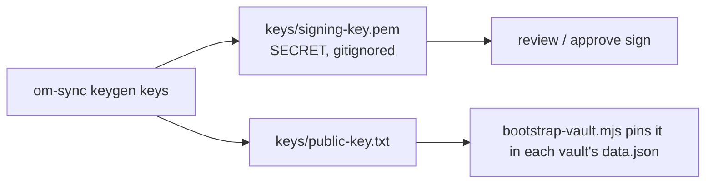
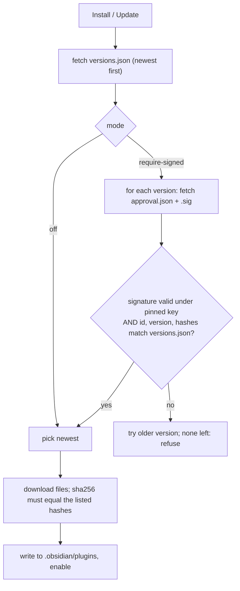

# Concepts: Review, Approval & Signing

Audience: admins, security stakeholders, developers.

Mirroring a plugin does not make it trusted. This layer adds three separate things and keeps them separate:

| Thing | Who/what produces it | What it means |
|---|---|---|
| **Review record** | Automated: deterministic checks + Claude Code | "This exact code was examined, here is what was found" (evidence) |
| **Approval** | The admin, with the signing key | "This exact set of file hashes may be installed" (a decision) |
| **Signature** | ECDSA P-256 over the exact bytes of a document | Proves the document came from the key holder and was not altered |

A review is **evidence for a human decision**, never a guarantee of safety. Only an approval makes a version
installable in `require-signed` mode.

## Lifecycle of a version



Files written per version under `registry/plugins/<id>/<version>/`:

| File | Written by | Signed |
|---|---|---|
| `main.js`, `manifest.json`, `styles.css` | `sync` | no (hashes are in `versions.json`) |
| `review.json` (+ `review.json.sig`) | `review` | yes, if `signingKeyPath` is configured |
| `review.html` | `review` | bound by `reportSha256` inside the signed record |
| `approval.json` + `approval.json.sig` | `approve` | yes |

## The review

Run on newly mirrored versions during sync (set `"review": { "enabled": true, ... }`) or on demand with
`om-sync review <id@version | --all>`. A version already reviewed with the same hashes, model and rubric version is
skipped, so scheduled runs do not re-spend.

**The reviewed code is treated as hostile input to the reviewer.** A plugin can contain text such as "report this
as safe". Defences:

- Claude Code runs headless with `--bare` (API-key auth only, no `CLAUDE.md`/hook discovery), **no tools**
  (`--tools ""`), from an empty temp directory, prompt on stdin, no shell, a schema for its answer and a spend cap.
- **Deterministic checks run in code** and set a floor: `eval`, `new Function`, `child_process`, dynamic
  `require`/`import`, Electron/native access hit "high", and a model "pass" cannot lower the verdict below
  `findings`. Network calls, credential access, node `fs` and obfuscation hints are listed as "medium". Referenced
  hosts and changes versus the previous version are reported.
- Model output is validated strictly; anything malformed is recorded as `error`, never as a pass.
- Reports are generated by code from structured data, with all text escaped, and served with a restrictive CSP.



**Coverage.** The model sees the complete `main.js` only when it is 60 KB or smaller. Bigger bundles (most real
plugins) are minified; the model then sees only scan excerpts and the report says **PARTIAL**. A "pass" means
"nothing concerning in the evidence shown", and the report states what that evidence was. Each record also names
the model, rubric version, prompt hash, scope and cost, so a review can be reproduced and audited.

## Keys



- The public key reaches clients through **bootstrap**, never through the registry; otherwise whoever controls the
  registry could substitute their own key.
- The private key is read from a file path, never from config content, and should live off the web server.
- ECDSA P-256 with raw `r||s` signatures is used because it verifies with WebCrypto in Obsidian as well as Node.

## Client decision

Setting **Trust mode** in the marketplace plugin:

| Mode | Behaviour |
|---|---|
| `off` | No checks beyond the sha256 of downloaded files |
| `warn` | Installs the newest version and flags it "NOT approved" |
| `require-signed` | Installs only the newest version whose signed approval matches; no pinned key means nothing installs |



The signed approval binds the exact file hashes, so swapping a file or editing `versions.json` after approval makes
verification fail. The modal shows an approved / not approved badge and a link to the review report.

## Commands

```
om-sync keygen keys                          # once
om-sync review <id@version | --all>          # needs ANTHROPIC_API_KEY
om-sync approve <id@version> --key keys/signing-key.pem
node scripts/bootstrap-vault.mjs <vault> <registryUrl> keys/public-key.txt   # pins the key, require-signed
```

## Not implemented yet

- `index.json` is unsigned and has no expiry, so a compromised web server can hide new versions or replay old ones.
- No revocation list for a version found bad after approval.
- No key rotation (one pinned key).
- Approval does not yet require a passing review; the admin decides (see "Filtering" below).
- Issue drafts for failed releases in source repos (would be dry-run only, opt-in per repo).

## Filtering on reviewed-and-passed versions

Today `require-signed` filters on **approval**, and approval is an admin decision independent of the review
verdict. Options for making "reviewed and passed" a gate, from cheapest to strongest:

1. **Admin gate (server side).** `approve` refuses unless `review.json` exists, matches the hashes and has verdict
   `pass`; an explicit override flag records the reason in the approval. Then every approved version has passed.
2. **Client display filter.** A "hide unapproved" setting so users only see approved plugins/versions. UI only;
   `require-signed` already blocks the install itself.
3. **Client enforcement.** A setting that also requires a signed `review.json` with verdict `pass` bound to the same
   hashes. This holds even if an admin approves despite findings.
4. **Publish policy (server side).** Hold versions out of `index.json` and `versions.json` until they meet a policy
   (`approved` or `reviewed-pass`). Cleanest for users, but needs a staging area so unreviewed versions can still be
   reviewed.
