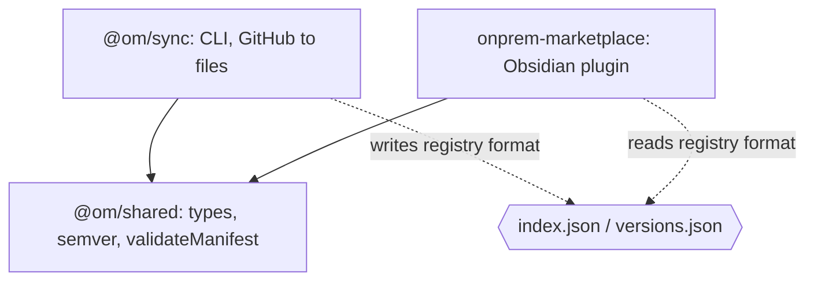
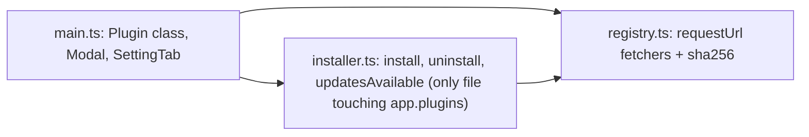

# Concepts: Developer Guide

Audience: contributors.

## Package dependency graph

`@om/shared` also holds `attest.ts` (signature verification, `checkApproval`, `selectVersion`) so the plugin and the tests share one implementation. `@om/shared` is consumed as TypeScript source (`main: src/index.ts`), so there is no separate compile step to
rely on; however the root `npm run build` builds it first anyway.

## Plugin internals

- `main.ts` - lifecycle (`onload`), ribbon icon, commands (`open`, `update-all`), periodic update check, UI.
- `registry.ts` - the only network code; uses Obsidian's `requestUrl` (bypasses CORS) and Web Crypto for sha256.
- `installer.ts` - verify-then-write install flow and the isolated `PluginManager` shim over undocumented APIs.

## Sync internals

- `signing.ts` - key generation, ECDSA signing, `approveVersion`.
- `review.ts` / `staticchecks.ts` - review pipeline: deterministic checks, injectable `Reviewer` (tests mock it), `claudeReviewer` (spawns Claude Code), report rendering.
- `cli.ts` - subcommands `keygen`, `review`, `approve`; default is sync.
- `sync.ts` exports `syncRegistry(cfg, fetcher)`, `rebuildIndex()`, `makeFetcher(token)`.
- The `Fetcher` type is injectable; tests supply a mock returning `Response` objects, so no network or GitHub is
  needed. Follow the pattern in `packages/sync/test/sync.test.ts` (temp `outDir` via `mkdtemp`).
- `cli.ts` is a thin wrapper: load config, read token from `process.env[cfg.tokenEnv]`, run, set exit code.

## Common changes

| Change | Touch |
|---|---|
| Add a field to the registry | `shared/src/index.ts` first, then `sync.ts` (write) and plugin (read) |
| Change what counts as a valid release | `sync.ts` release loop + `validateManifest` |
| Support a new Obsidian API behavior | `installer.ts` only |
| Add a UI feature | `main.ts` |

## Build & test

See `CLAUDE.md` for commands. Build outputs (`dist/`, `registry/`, `packages/plugin/main.js`) are gitignored.

## Upstream/downstream note

This repo is the home version and may be an upstream for a work version. Keep org-specific values
(`githubApiBase`, registry URL defaults, repo list) in configuration so that patches apply cleanly.
