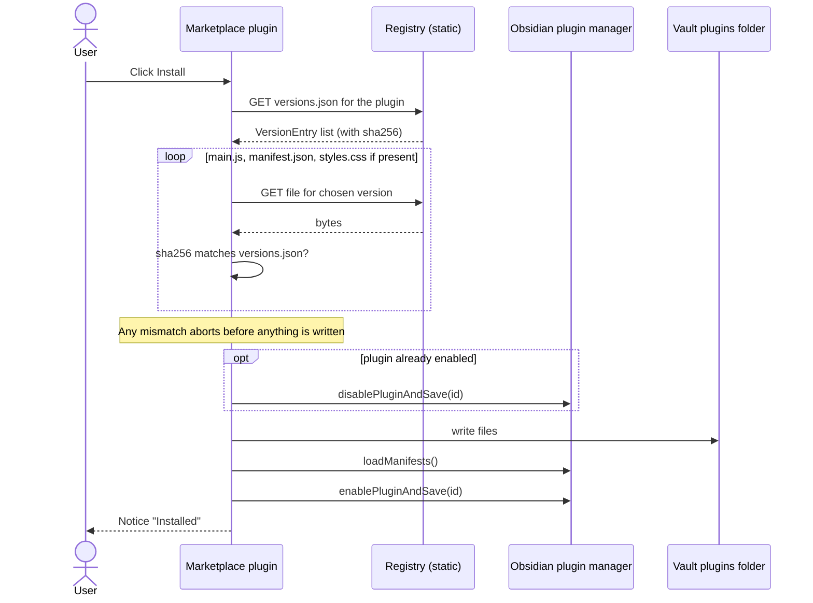
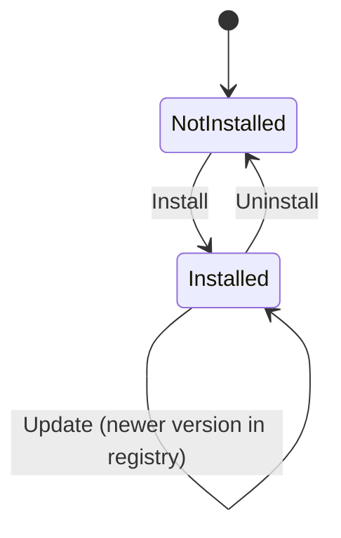

# Concepts: Install & Update Lifecycle (Client)

Audience: users and developers.

## Bootstrapping a vault

`node scripts/bootstrap-vault.mjs <vaultPath> <registryUrl>` copies `main.js` + `manifest.json` into
`.obsidian/plugins/onprem-marketplace/`, writes `data.json` with the registry URL, and adds the plugin id to
`community-plugins.json`. The user then turns off Restricted mode and reloads Obsidian.

## Installing a plugin

All files are downloaded and verified **before** any write, so a bad download never leaves a half-installed plugin.

## Update checks

On layout-ready and then every `checkIntervalMinutes` (minimum 5), the plugin fetches `index.json` and compares
`latestVersion` against each *installed* plugin's version using semver. If any are newer it shows a notice; it
does **not** auto-install. The user runs the command *Update all marketplace plugins* (or clicks Update in the
modal).

The marketplace itself cannot be uninstalled from its own UI.

## Compatibility gating

`isCompatible()` hides the Install/Update button when the running Obsidian is older than `minAppVersion` or when
the plugin is `isDesktopOnly` and the user is on mobile.

## The undocumented-API risk

Enabling/disabling plugins programmatically uses Obsidian's **undocumented** `app.plugins` object. All such use
is confined to `packages/plugin/src/installer.ts` (the `PluginManager` interface). After an Obsidian upgrade, if
installs stop activating plugins, that file is the first place to look. This has not yet been validated in a
running Obsidian (see `docs/README.md`).
