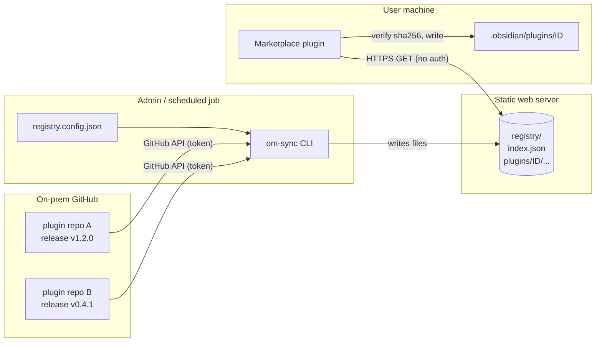

# Concepts: System Overview

Audience: everyone. Start here.

## The problem

Obsidian's community plugin browser only talks to Obsidian's public catalog. In an environment where plugins must
come from an internal source, there is no built-in way to point it elsewhere. This project fills that gap with
two cooperating pieces and one deliberate design choice: **the registry is just static files**.

| Piece | What it is | Runs where |
|---|---|---|
| **Sync** (`packages/sync`) | CLI that mirrors plugin releases from an on-prem GitHub into a folder of files | Admin / scheduled job |
| **Registry** (`registry/`) | Plain files served by any web server (IIS, nginx, file share). No code, no database | Web server |
| **Marketplace plugin** (`packages/plugin`) | Obsidian plugin that lists, installs, updates and removes plugins from the registry | Every user's Obsidian |
| **Shared** (`packages/shared`) | Types and version/manifest validation used by both sides | Build time |

## Big picture

Key properties:

- **One-way flow.** GitHub -> sync -> registry -> clients. Clients never talk to GitHub and never hold a token.
- **Registry is inert.** Serving it needs no application server; a compromised web server cannot execute anything
  by itself (but can serve altered files; see the [security guide](security.md)).
- **Admin curates.** Only repos listed in `registry.config.json` are mirrored.

## Glossary

- **Nominated repo** - a GitHub repo listed in `registry.config.json`.
- **Release** - a non-draft, non-prerelease GitHub release whose tag equals the plugin's `manifest.json` version,
  with `main.js`, `manifest.json` and optional `styles.css` attached (the standard Obsidian layout).
- **Registry** - the output folder (`outDir`, default `registry/`).
- **Bootstrap** - one-time copy of the marketplace plugin into a vault (`scripts/bootstrap-vault.mjs`).
- **Restricted mode** - Obsidian's switch that blocks all community plugins; must be off for the marketplace to run.

## Where to go next

- Operating it: [Registry & sync](registry-and-sync.md)
- Extending it: [Developer guide](developer-guide.md)
- Assessing it: [Security & trust model](security.md)
- Client behavior: [Install & update lifecycle](install-lifecycle.md)
