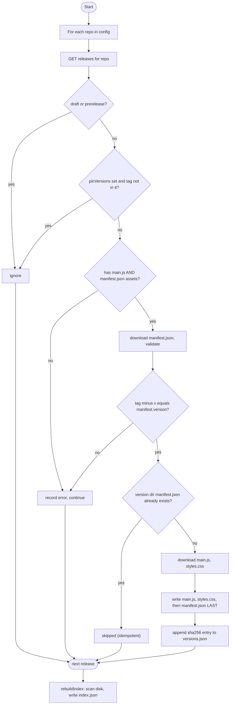
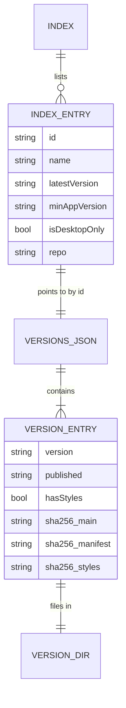

# Concepts: Registry & Sync

Audience: admins and developers.

## What sync does

`syncRegistry()` (`packages/sync/src/sync.ts`) is run by `node packages/sync/dist/cli.js` and is safe to run
repeatedly on a schedule.



Design points worth knowing:

- **Per-release errors do not abort the run.** They are collected; the CLI exits `1` if any occurred, so a
  scheduler can alert while other plugins still update.
- **`manifest.json` is written last** and is the "version complete" marker. A crash mid-download leaves a
  directory that the next run treats as incomplete and retries.
- **`index.json` is rebuilt from disk**, not from this run's results, so plugins whose repos are temporarily
  unreachable (or removed from config) remain listed.
- **Versions are immutable once synced.** Re-publishing a tag with different bytes does *not* overwrite the
  mirrored copy (it is skipped). Bump the version instead.
- Pre-release and draft releases are never mirrored. `pinVersions` restricts a repo to specific versions.

## Registry layout

```
registry/
  index.json                       # one IndexEntry per plugin (latest version only)
  plugins/
    <id>/
      versions.json                # VersionEntry[] newest first, with sha256 per file
      <version>/
        manifest.json
        main.js
        styles.css                 # optional
```



Types are defined in `packages/shared/src/index.ts`; this file format is the contract between sync and the
plugin, so change the types first and update both sides.

## Admin operations

| Task | How |
|---|---|
| Add a plugin | Add `{ "repo": "org/name" }` to `repos`, re-run sync |
| Hold a plugin at certain versions | `"pinVersions": ["1.2.0"]` |
| Limit how much history is mirrored | `"maxVersions": 5` at top level, or per repo; newest N releases only |
| Avoid GitHub rate limits | Set the token env var (5000 requests/hr vs 60 unauthenticated). Sync stops early with a clear message if the limit is hit; re-run later and it resumes (finished versions are skipped) |
| Remove a plugin from the catalog | Remove it from config **and** delete `registry/plugins/<id>` (sync never deletes) |
| Self-update the marketplace | Nominate its own repo; its manifest id must be `onprem-marketplace` |
| Schedule | Task Scheduler / cron running the CLI; set the env var named by `tokenEnv` |
| Serve | Point any static server at `registry/`; clients need only read access |

`registry.config.json` fields: `githubApiBase` (e.g. `https://github.corp/api/v3`), `tokenEnv` (name of the env
var holding a read-only token), `outDir`, `repos[]`.
