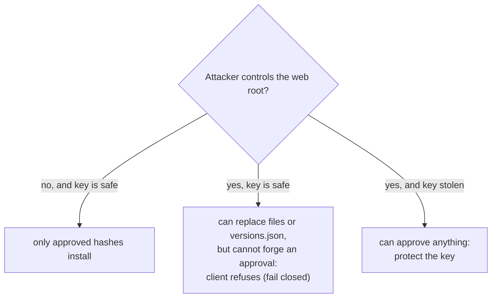

# Concepts: Security & Trust Model

Audience: security stakeholders and reviewers.

## What is being protected

Obsidian plugins are arbitrary JavaScript running with the user's privileges and full vault access. Installing a
plugin is therefore **code distribution**. The goal of this system is to restrict that distribution to code the
organization has chosen and approved, without relying on the public catalog.

## Trust boundaries

```mermaid
flowchart LR
    subgraph T1["Zone: source control"]
        GH["GitHub (nominated repos)"]
    end
    subgraph T2["Zone: admin host"]
        SYNC["om-sync + token"]
        REV["Claude Code reviewer + API key"]
        KEY["signing private key"]
    end
    subgraph T3["Zone: web root"]
        REG[("Registry files")]
    end
    subgraph T4["Zone: endpoint"]
        MP["Marketplace plugin + pinned public key"]
        PL["Installed plugins (full user privileges)"]
    end
    GH -->|"1 token, TLS"| SYNC
    SYNC --> REV
    REV --> KEY
    KEY -->|"2 signed records, file write"| REG
    REG -->|"3 HTTPS, unauthenticated"| MP
    MP -->|"4 signature + sha256 check"| PL
```

| # | Boundary | Control | Gap / note |
|---|---|---|---|
| 1 | GitHub -> sync | Token via env var (value never in config); only nominated repos; drafts/prereleases skipped; tag must equal manifest version; manifest validated (path-safe `id` and version); `maxVersions` cap; stops cleanly on rate limit | Use a read-only, least-privilege token |
| 2 | sync -> registry | Versions are write-once; review records and approvals are signed | Whoever can write the web root can still add or remove files; see below |
| 3 | registry -> client | TLS if the URL is https; client validates every id/version taken from the registry before using it in a path | No client authentication; anyone who can reach the URL can read plugins |
| 4 | client verification | sha256 of each file; in `require-signed` mode also a signature check against a key pinned at bootstrap | See "What the signature does and does not protect" |

## What the signature does and does not protect

In `require-signed` mode a version installs only if an `approval.json` is signed by the pinned key and its id,
version and file hashes match what the client is about to install. The public key reaches clients at bootstrap, not
from the registry.

Protected: swapped or modified plugin files, edited `versions.json` hashes, approvals copied between versions,
forged approver names, and wrong-key approvals (all covered by tests).

**Not protected** (known gaps):

1. **`index.json` is unsigned and has no expiry.** A compromised web server can hide new versions, or serve an old
   catalog (rollback to older approved versions). It cannot make a client install unapproved code.
2. **No revocation.** A version approved earlier and later found bad stays installable until it is removed from the
   registry; there is no signed deny list.
3. **Single pinned key, no rotation.** Replacing the key means re-bootstrapping vaults.
4. **`off` and `warn` modes give integrity only.** The sha256 values come from the same registry as the files, so
   without signatures they catch corruption, not a malicious registry. Use `require-signed` for the work version.
5. **Approval is a human decision.** `approve` refuses unless the exact files have a passing review, but an admin can
   `--override` with a recorded reason; clients can additionally require a signed passing review. See
   [Review, approval & signing](attestation.md).

## The automated review

Reviews are produced by Claude Code and by deterministic checks. Treat them as **advisory evidence**:

- The reviewed code is untrusted input to the reviewer. Mitigations: no tools, empty working directory, no shell,
  strict output schema, deterministic checks that a model cannot downgrade, escaped HTML reports.
- A model cannot meaningfully read multi-megabyte minified bundles; large plugins get a **partial** review and the
  report says so. A "pass" means nothing concerning was found in the evidence shown.
- Reviews send plugin code to a model API. For the work version this must be an approved model or endpoint; each
  record names the model used, which is also the audit trail.
- A tool-enabled review harness (wrapper `stageFiles`) is a larger attack surface than a text-only call. Its file
  access must be read-only and confined to the staging directory; the review stage stages only plugin files, detects
  modification, and discards secret-like output, but cannot enforce the harness sandbox itself. See
  [Review, approval & signing](attestation.md).
- The API key is read only from the environment of the sync host and is never written to config or the registry.

## Other review notes

1. **Plugin id namespace is not enforced per repo.** Any nominated repo can publish a manifest claiming any `id`
   (including `onprem-marketplace`, the self-update path). Only nominate repos with trusted maintainers; a future
   check could bind id to repo. With `require-signed`, the admin still has to approve each version.
2. **Registry input is validated client-side.** Plugin ids and versions from `index.json`/`versions.json` are checked
   against the same path-safe patterns sync uses (`isValidPluginId`, `isSafeVersion` in `@om/shared`); invalid
   entries are dropped and `install`/`uninstall` refuse invalid ids, so a malicious registry cannot steer writes
   outside `.obsidian/plugins/`.
3. **Updates are pull-with-consent.** The client only notifies; installs and updates need a user action. In
   `require-signed` mode "Update all" moves only to the newest *approved* version.
4. **Restricted mode must be off.** This is an Obsidian-level setting that also permits any other community plugin
   already placed in the vault; consider vault-level controls if that matters.
5. **No removal propagation.** Removing a plugin from config does not remove it from the registry or from clients
   that installed it; delete the registry directory to stop distribution.
6. **Secrets handling.** The GitHub token, the Anthropic API key and the signing private key stay on the sync/admin
   host. `*.pem`, `*.key`, `keys/` and `signing-key*` are gitignored. Clients hold only the public key.
7. **Rate limits are handled safely.** Sync stops the run with a clear message instead of retrying; nothing partial
   is marked complete (`manifest.json` is written last).
8. **The optional admin web service has no approve/sign capability.** It can trigger sync and review and show status,
   behind mTLS and/or password login (see [Admin service](../admin.md)). A compromised admin login cannot sign an
   approval, but note that mounting `review.signingKeyPath` into it lets it sign review records, which clients using
   `requireReviewPass` trust. Sessions are in memory, and every allowed admin has the same rights. Admins can withdraw, hold back
   or release versions and revoke approvals (all of which only tighten what clients see or restore what policy already allows), and
   leave shared triage notes. Withdrawing does not uninstall copies already on clients; a signed revocation list would be needed for that.
   In the container deployment the model call runs in a separate reviewer container that holds the Anthropic key and sees
   no registry files; the admin validates what it returns exactly like any model output, so a compromised or confused
   reviewer can cause an `error` verdict (or wasted spend) but cannot produce a pass, write into the registry, or reach the
   admin's secrets.
9. **Client activity is inferred, not attested.** The admin service derives it from the web server access log (no
   client reports anything), so it can be skewed by shared addresses, failed downloads and deliberate requests. It
   must not feed a trust decision. The published `stats.json` is counts-only, unsigned and display-only. A Splunk HEC
   token held by the admin service can write to the configured index; scope it to that index only.

## Data flows and privacy

Clients make read-only GET requests to the registry; no telemetry or third-party endpoints are contacted by this
code. The registry web server's access logs will show which clients fetch which plugins and versions. Plugin code
and manifests are sent to the review model during a review.
