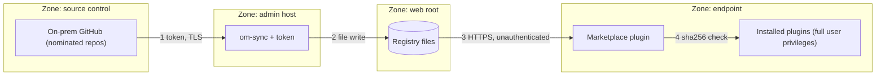
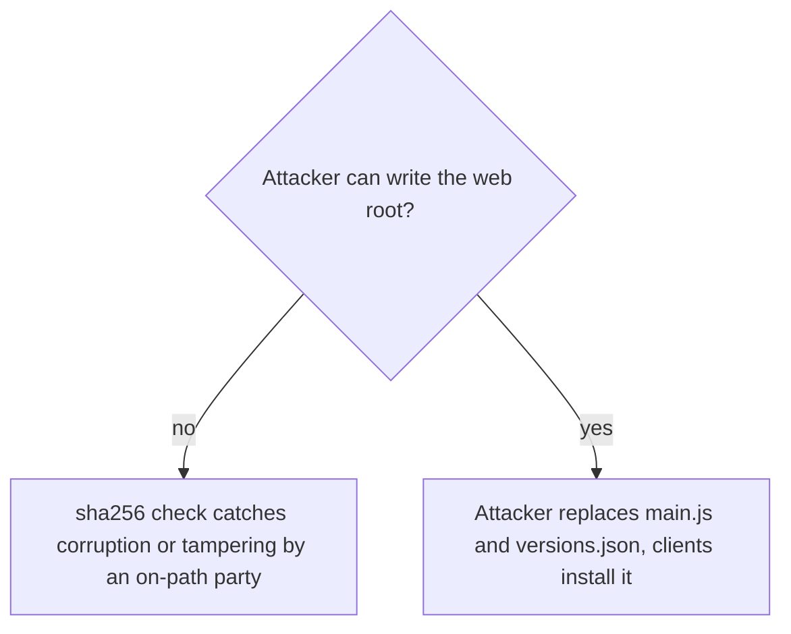

# Concepts: Security & Trust Model

Audience: security stakeholders and reviewers.

## What is being protected

Obsidian plugins are arbitrary JavaScript running with the user's privileges and full vault access. Installing a
plugin is therefore **code distribution**. The goal of this system is to restrict that distribution to code from
repositories the organization controls, without relying on the public catalog.

## Trust boundaries

| # | Boundary | Control today | Gap / note |
|---|---|---|---|
| 1 | GitHub -> sync | Token via env var (name in config, value never stored); only nominated repos; drafts/prereleases skipped; tag must equal manifest version; manifest validated (path-safe `id` and version) | Use a read-only, least-privilege token |
| 2 | sync -> registry | Versions are write-once (existing versions not overwritten) | Anyone who can write the web root controls what clients run |
| 3 | registry -> client | TLS if the registry URL is https | No client authentication; anyone who can reach the URL can read plugins |
| 4 | client verification | sha256 of each file compared to `versions.json` before any write | See "integrity vs authenticity" |

## Integrity vs. authenticity (the important caveat)

The hashes in `versions.json` live **in the same registry** as the files. The check protects against corruption
and partial/mismatched uploads, but **not against a compromised registry**: an attacker who can alter a plugin's
`main.js` can alter its hash too. There are no signatures.

Compensating controls today: restrict write access to the web root (called out in `docs/README.md`), serve over
HTTPS, and nominate only repos you control. Possible hardening (not implemented): sign `index.json`/`versions.json`
with a key whose public half is embedded in the marketplace plugin, so the web server need not be trusted.

## Review notes for stakeholders

Observations from reading the code, worth tracking as hardening items:

1. **Plugin id namespace is not enforced per repo.** Any nominated repo can publish a manifest claiming any `id`
   (including `onprem-marketplace`, the self-update path). Only nominate repos with trusted maintainers; a
   future check could bind id -> repo.
2. **Registry input is validated client-side.** Plugin ids and versions from `index.json`/`versions.json` are
   checked against the same path-safe patterns sync uses (`isValidPluginId`, `isSafeVersion` in `@om/shared`);
   invalid entries are dropped, and `install`/`uninstall` refuse invalid ids, so a malicious registry cannot
   steer writes outside `.obsidian/plugins/`.
3. **Updates are pull-with-consent.** The client only notifies; installs and updates need a user action, but
   the "Update all" command installs whatever the registry's latest is.
4. **Restricted mode must be off.** This is an Obsidian-level setting that also permits any other community
   plugin already placed in the vault; consider vault-level controls if that matters.
5. **No removal propagation.** Removing a plugin from config does not remove it from the registry or from clients
   that installed it; delete the registry directory to stop distribution.
6. **Sync token scope.** The token is read by the sync host only; clients never see it.

## Data flows and privacy

Clients make read-only GET requests to the registry; no telemetry or third-party endpoints are contacted by this
code. The registry web server's access logs will show which clients fetch which plugins and versions.
